# Cleardesk — AI Receptionist

Cleardesk is a conversational front desk for real-estate enquiries, grounded business answers and deliberately confirmed appointments. Customers can type or speak in their browser, while staff manage conversations, customers, bookings and business knowledge in one console.

💬 &nbsp; 🎙️ &nbsp; 📅 &nbsp; 🧠 &nbsp; 🔒

**React · TypeScript · Vite · Tailwind CSS · Fastify · Supabase/PostgreSQL · Ollama · Faster-Whisper · Google Calendar**

<p align="center">
  
</p>
<p align="center">
  
  
</p>

## What it does

| Capability | V1 behavior |
| --- | --- |
| Customer chat | Contextual enquiries, missing-detail clarification and answers grounded in saved FAQs. |
| Browser voice | Local transcription, silence detection, browser speech playback, mute and text handoff. **No telephone/PSTN calling.** |
| Booking | Extract details → check availability → offer → explicit acceptance → recheck → create → verify and persist the event identity. |
| Cancellation | A separate deliberate workflow; ending a conversation does not cancel its appointment. |
| Human handoff | Flags the conversation in the admin console; does not claim to send an external notification. |
| Admin console | Customers, transcripts, appointment outcomes, business settings, model discovery and Calendar metadata. |
| AI boundaries | Validated structured output; models cannot confirm bookings or administer the application. |

### Built around property enquiries

Try “I want to buy a 3BHK flat,” followed by “My budget is 80 lakh,” then “Can I book a site visit?” Cleardesk retains preferences, requests missing identity/contact/time details, and routes unanswered inventory questions to staff. It does not invent available properties, prices or confirmed bookings.

## How booking works

[](docs/assets/architecture.svg)

[Mermaid source](docs/assets/architecture.mmd). The SVG export keeps the diagram readable when GitHub’s rich renderer is unavailable.

An offer alone creates no event. Acceptance requires the conversation token, current offer token and explicit decision. A durable idempotency identity prevents duplicates; uncertain results remain **unresolved** for reconciliation, never blindly retried under a new identity. Replies and admin status reflect stored outcomes. Google writes require deliberate configuration and authorization; the default is `CALENDAR_MODE=mock`.

## Configure your business

<table width="100%"><tr>
<td width="52%">
<p><strong>Admin → Business settings</strong> holds company information, greeting, hours/timezone, services, appointment types/duration, escalation rules and manually maintained FAQs.</p>
<p>Adapt these for another agency or business. Hours and services synchronize generated FAQ entries; maintain specific factual answers yourself. This is <strong>one business per installation</strong>, not built-in multi-tenant SaaS or automatic document ingestion.</p>
</td>
<td width="48%"></td>
</tr></table>

## Choose your AI runtime

<table width="100%"><tr>
<td width="52%">
<p>Install <a href="https://ollama.com/download/windows">Ollama for Windows</a> and pull <code>qwen3:1.7b</code>, the tested default. Admin → AI models discovers installed Ollama models and supports explicit local selection. Choose models that fit available RAM and validate their structured output.</p>
<p>Provider registration, server-side API-key storage and OpenAI-compatible connectivity configuration exist. The shipped orchestrator nevertheless <strong>refuses cloud inference</strong>, even with an active cloud entry. Adding a key does not enable inference: explicit owner approval and reviewed integration are still required.</p>
</td>
<td width="48%"></td>
</tr></table>

Arbitrary downloaded weights are not automatically supported. Use an Ollama-supported model or its [model import procedure](https://docs.ollama.com/import), then test compatibility. Speech and inference run sequentially; memory safeguards may pause voice. Authorized cloud services can transmit prompts externally and incur usage charges. There is no silent paid fallback.

## Windows PowerShell quickstart

Prerequisites: **Node.js 24+**, Python 3.11, Ollama and your own configured Supabase project. Review [database setup](docs/backend/SUPABASE.md), migrations and [admin authentication](docs/backend/AUTH.md) before provisioning. These commands do not migrate or seed a remote database.

```powershell
git clone https://github.com/Aryan4verma/AI-RECEPTIONIST.git Cleardesk
Set-Location Cleardesk
npm ci
if (!(Test-Path .env)) { Copy-Item .env.example .env }
ollama pull qwen3:1.7b
py -3.11 -m venv sidecar\whisper\.venv
& .\sidecar\whisper\.venv\Scripts\python.exe -m pip install -r sidecar\whisper\requirements.txt
```

Fill `.env` privately **before starting**:

| Location | Setup |
| --- | --- |
| Backend `.env` | Your `SUPABASE_URL`, server-only `SUPABASE_SERVICE_ROLE_KEY`, `SUPABASE_DB_URL`, trusted `SUPABASE_DB_CA_CERT_PATH` and strong `TOKEN_HASH_SECRET`. Replace the example project URL with your own. |
| Runtime | Keep `CALENDAR_MODE=mock`; Ollama normally listens on `http://localhost:11434`. Start its app; avoid a duplicate server. |
| Frontend `.env` | Your `VITE_SUPABASE_URL` and client-safe `VITE_SUPABASE_ANON_KEY`. Never put database, service-role, Google or provider secrets in `VITE_*`. |

The backend starts speech on demand; first use may download the tiny speech model. Run `npm run dev` from the root. In a second PowerShell terminal at the repository root:

```powershell
Set-Location frontend
npm ci
if (!(Test-Path .env)) { Copy-Item .env.example .env }
# Fill the two client-safe values above, then:
npm run dev -- --host 127.0.0.1 --port 5174 --strictPort
```

Open `http://localhost:5174`; staff use `/admin/login`. Owner provisioning must create both a Supabase Auth account and `app_admins` membership. Microphone access requires HTTPS or localhost. For OAuth, follow the four `GOOGLE_*` settings and exact callback in [.env.example](.env.example); use a dedicated test calendar, retaining mock mode until separately authorized.

## Verify and contribute

From the repository root:

```powershell
npm run typecheck
npm run build
npm test -- --exclude "**/*.live.test.ts" --maxWorkers=1
npm --prefix frontend test -- --maxWorkers=1
npm --prefix frontend run build
```

The recorded V1 gate passed **319 backend tests, 27 frontend tests and both builds/typechecks**. Fixture results are distinct from microphone, real-model and remote integration evidence. [TESTING](docs/backend/TESTING.md) covers gated live checks and the read-only DB verifier, which currently reports the known runtime-role security failure.

[API](docs/backend/API.md) · [Handoff](docs/backend/HANDOFF.md) · [Voice verification](docs/frontend/CALLING.md) · [Security](docs/backend/SECURITY.md) · [V1 readiness](docs/backend/V1_READINESS.md)

## Honest V1 status and privacy

**Suitable for supervised local text/mock demos; not production-ready.** A bounded real Google booking/cancellation test passed. Genuine voice transcription was exercised, but complete acoustic verification remains outstanding; low RAM and latency can limit usability. SEC-F13's overly privileged PostgreSQL runtime connection, retention/deployment gates, isolated DB replay and residual prompt-injection susceptibility remain open. Review the readiness matrix before deployment.

Local AI inference is possible; this is **not fully offline**. Supabase processes application records/authentication; authorized Google integration processes Calendar data; any separately enabled cloud AI would process its requests. Audio persistence is off by default and consent-gated; transient transcription still processes microphone audio.

## License

Original code/documentation: **MIT**, copyright © 2026 Aryan Verma; see [LICENSE](LICENSE). Reuse, modification and commercial use are permitted under its conditions. Fonts, photographs, dependencies, screenshots and model weights retain their own terms; MIT does not relicense third-party content. See [third-party notices](THIRD_PARTY_NOTICES.md).
